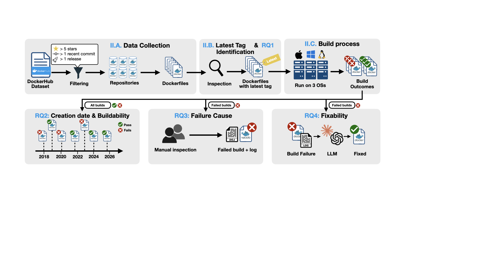

# Your Latest is Not My Latest

### Replication package for *"On the Prevalence and Repair of Time-Induced Docker Build Failures"*



A Docker image is built on top of a **base image**. Developers who default to the
`latest` tag build against whatever base image and dependency versions happen to be
available *at build time*. As a result, a Dockerfile that builds successfully today can
fail to build later **with no change to its own code** — a failure we call a
**time-induced failure**.

This repository contains the code and data pipeline used to study, quantify, categorize,
and automatically repair time-induced Docker build failures across a large corpus of
open-source GitHub repositories.

---

## Key findings

- **Prevalence of `latest`** — The `latest` tag appears in **24.0%** of studied
  repositories (2,198 / 9,179) and **17.8%** of Dockerfiles (3,819 / 21,481), and tagging
  strategies rarely change across releases.
- **Time-induced failures are common** — **37.5%** of build failures among `latest`-tagged
  Dockerfiles are time-induced (caused by upstream base-image drift, not code changes).
  Time-induced failures skew older (median age **730** vs **546** days for successful builds).
- **Root causes** — Dependency & package resolution errors (**52%**) and missing/deprecated
  base images (**38%**) dominate, followed by command-execution (9%) and
  no-longer-supported (1%) errors.
- **LLM repair** — The agentic setting beats direct API calls for both providers. Best:
  **Codex (agentic, GPT-5.5) repairs 68.0%**; Claude Code 48.0%; worst: non-agentic
  **Claude Opus 4.8 (direct API) 32.0%**, GPT-5.5 (direct API) 35.0%.

---

## Research questions & pipeline

The pipeline (see figure above) maps directly onto the study's research questions and the
top-level directories:

| Stage | Directory | Purpose |
|-------|-----------|---------|
| Data collection & `latest` identification (RQ1) | [`check_latest_in_dockerfile/`](check_latest_in_dockerfile/) | Clone repos, find Dockerfiles, detect unpinned `:latest` base images, track tag changes across releases |
| Build process & buildability (RQ2) | [`check_build_latest/`](check_build_latest/) | Check out each repo at its latest release, build every Dockerfile, record success/failure |
| Failure-cause analysis (RQ2 / RQ3) | [`classify/`](classify/) + `check_build_latest/*` | Classify failures as time-induced vs not, and by error category |
| Automated repair (RQ4) | [`dockerfile_repair/`](dockerfile_repair/) | Ask LLMs (API or agentic CLI) to fix broken Dockerfiles, then rebuild to verify |

---

## Repository structure

```
.
├── input/
│   └── repo_list.csv                 # Seed list of GitHub repos (owner/repo per line)
├── check_latest_in_dockerfile/       # RQ1: detect `:latest` usage & tag changes
│   ├── check_latest_in_dockerfile.py
│   ├── check_release_version.py
│   ├── check_change_tag.py
│   └── analysis_tag_change.py
├── check_build_latest/               # RQ2/RQ3: build & analyze
│   ├── check_build_latest.py         # main build tester (Linux/macOS)
│   ├── check_build_latest_windows.py # Windows variant
│   ├── error_categorize.py
│   ├── filter_result.py
│   ├── merge_filter_result.py
│   ├── count_stats.py
│   ├── convert_stats_csv.py
│   ├── compare_multiple_result_os.py
│   ├── run_build_check.sh / .ps1     # convenience runners
│   └── run_filter_and_summary.sh
├── classify/                         # RQ2/RQ3: label failures
│   ├── time_induced.py               # time-induced vs non-time-induced
│   └── error_category.py             # error-category classification
├── dockerfile_repair/                # RQ4: LLM repair
│   ├── llm_repair.py                 # main repair driver (Linux/macOS)
│   ├── llm_repair_windows.py         # Windows variant
│   └── summarize_repair_os.py        # aggregate repair results → CSV
├── figure/overview.png               # study overview figure
├── output/                           # generated results (created at runtime)
├── requirements.txt
└── sample.env                        # template for required secrets
```

---

## Setup

### 1. Prerequisites

- **Python 3.9+**
- **Docker** (the study used Docker `29.0.3`) — required for the build and repair stages.
- **GitHub SSH access** — repos are cloned over SSH (`git@github.com:owner/repo.git`), so an
  SSH key must be configured on your GitHub account.
- **Agentic CLIs** (only for `--mode agent` repair): Claude Code, Codex, and/or Gemini CLI.
  ```bash
  npm i -g @anthropic-ai/claude-code   # Claude Code
  npm i -g @openai/codex               # Codex
  npm i -g @google/gemini-cli          # Gemini CLI
  ```

### 2. Install Python dependencies

```bash
python -m venv .venv
source .venv/bin/activate        # Windows: .venv\Scripts\activate
pip install -r requirements.txt
```

### 3. Configure secrets

Copy `sample.env` to `.env` and fill in the values you need:

```bash
cp sample.env .env
```

```dotenv
OPENAI_API_KEY=      # RQ4 repair with GPT / Codex
ANTHROPIC_API_KEY=   # RQ4 repair with Claude / Claude Code
GEMINI_API_KEY=      # RQ4 repair with Gemini
DOCKER_USER=         # optional: Docker Hub login to raise pull rate limits
DOCKER_PASS=
```

> **Do not commit real credentials.** Provide Docker/API secrets through `.env` (loaded via
> `python-dotenv`) or command-line flags — never hard-code them into the run scripts.
> A GitHub API token is also read from the `GITHUB_TOKEN` environment variable by the
> release/tag-analysis scripts.

---

## Usage

The stages are meant to run in order; each writes intermediate results under `output/` that
later stages consume.

### RQ1 — Identify Dockerfiles using `latest`

```bash
python check_latest_in_dockerfile/check_latest_in_dockerfile.py \
    --input_file input/repo_list.csv \
    --output_dir output \
    --clone_repo_dir repo \
    --index -1 --total_array_size 1        # or split into chunks for parallel runs
```

Release/tag-history analysis helpers:

```bash
python check_latest_in_dockerfile/check_release_version.py --input input/repo_list.csv
python check_latest_in_dockerfile/check_change_tag.py \
    --input_file output/change_tag_report.txt \
    --repo_list  input/repo_list.csv \
    --output_file output/tag_change_summary.txt
python check_latest_in_dockerfile/analysis_tag_change.py
```

### RQ2/RQ3 — Build every Dockerfile

Clones each repo, checks out the target revision (see *Methodology* below), and builds each
Dockerfile with `docker build --no-cache`. Builds that produce no output for 30 minutes are
killed and treated as failures.

```bash
python check_build_latest/check_build_latest.py \
    --input_dir  output/latest_check \
    --output_dir output/build_check \
    --year 2026 \
    --docker_user "$DOCKER_USER" --docker_pass "$DOCKER_PASS"
```

Windows uses the sibling script (run from an Administrator PowerShell with Docker Desktop):

```powershell
python check_build_latest\check_build_latest_windows.py --input_dir output\latest_check --output_dir output\build_check --year 2026
```

Post-process the raw build results into per-OS filtered results and statistics:

```bash
python check_build_latest/filter_result.py       --year 2026 --os linux    # also: mac, windows
python check_build_latest/merge_filter_result.py --year 2026
python check_build_latest/count_stats.py         --year 2026
python check_build_latest/error_categorize.py    --year 2026
python check_build_latest/compare_multiple_result_os.py --year 2026
python check_build_latest/convert_stats_csv.py
```

### Failure classification (RQ2/RQ3)

Label failures as time-induced or by error category. Both take an input CSV of failures and
write a labeled CSV (arguments are positional: `input` then `output`):

```bash
python classify/time_induced.py   failures.csv time_induced_labeled.csv
python classify/error_category.py failures.csv error_categorized.csv
```

### RQ4 — Repair broken Dockerfiles with LLMs

Reads a JSON file of broken builds (with their logs), asks the chosen model to fix each
Dockerfile, then rebuilds it in the controlled environment to verify the fix.

```bash
# Agentic mode (default): runs the provider's coding CLI inside a clone of the repo
python dockerfile_repair/llm_repair.py \
    --input  ""INPUT JSON FILE"" \
    --output output/dockerfile_repair \
    --provider gpt   --mode agent          # Codex (GPT-5.5)

python dockerfile_repair/llm_repair.py --input ... --provider claude --mode agent   # Claude Code

# Direct-API mode: single SDK call with the broken Dockerfile + log
python dockerfile_repair/llm_repair.py --input ... --provider claude --mode api
python dockerfile_repair/llm_repair.py --input ... --provider gpt    --mode api
```

Provider/model options: `--provider {gpt,claude,gemini}`, `--mode {agent,api}` (default
`agent`). Default models — `claude → claude-opus-4-8`, `gpt → gpt-5.5`,
`gemini → gemini-3.1-pro-preview` (override with `--model`). Use `llm_repair_windows.py`
on Windows.

Aggregate repair results across models and OSes into summary CSVs:

```bash
python dockerfile_repair/summarize_repair_os.py --base output/dockerfile_repair
```

---

## Methodology notes

- **Which revision is built/repaired.** To compare fairly against a model's knowledge, each
  repository is checked out at the **latest release tag whose commit date is on or before the
  cutoff date** (`CUTOFF_DATE = "2026-03-21"`). Release tags exclude pre-release keywords (`alpha`, `beta`, `rc`, `dev`, `nightly`, `snapshot`, `pre`, `debug`).
- **Build environment.** Builds were distributed across three machines / two architectures,
  all running Docker `29.0.3`:

  | OS | CPU | Arch |
  |----|-----|------|
  | Windows 11 Pro | Intel i9-12900K | amd64 |
  | RHEL 8.4 | Fujitsu A64FX | aarch64 |
  | macOS Tahoe 26.3.1 | Apple M3 | aarch64 |

---

## Data

- `input/repo_list.csv` — the seed list of GitHub repositories (`owner/repo`, one per line),
  derived from the Docker Hub dataset of Lin et al. and filtered to publicly accessible,
  actively maintained projects with ≥1 stable release and ≥5 stars/forks.
- `output/` — all generated artifacts (clone metadata, per-repo build results, filtered/merged
  JSON, statistics, error categorizations, and repair results). Created at runtime.

---

## Citation

If you use this replication package, please cite:


